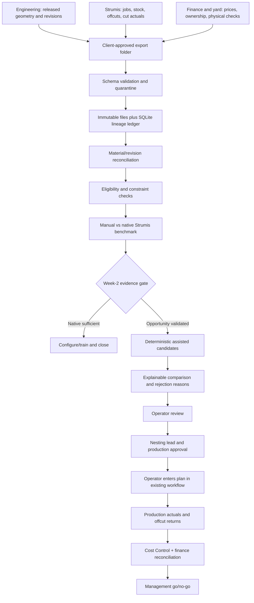

# Technical architecture - confidential

Pilot boundary: approved read-only exports, no production-system writes, no external AI calls. Strumis API/export support, licence and exact PLM are unknown.

| Component | Responsibility and failure behaviour |
|---|---|
| Export adapter | Parse agreed file contracts; capture source ID/hash and snapshot time; fail closed on unsupported schema |
| Validator | Required fields, referential/physical checks, duplicate IDs, dimensions and status; quarantine batch with row reasons |
| Ledger | Append-only run/review events; no overwriting input snapshots; distinguish stock identities and remnant parentage |
| Reconciler | Part + scrap + offcut mass balance; classify revisions, rework and unknowns; preserve unexplained variance |
| Eligibility service | Same-project, grade, section/thickness, availability, reservations, release and required heat lineage |
| Benchmark runner | Frozen inputs and settings, first-run selection, runtime limits, comparable planning effort |
| Candidate service | Native heuristic first; 1D first/best fit and bounded optimisation only if warranted; no plate production engine |
| Review report | Show source provenance, plan delta, constraints, stock IDs, rejected alternatives and economic assumptions |
| Results scorecard | Observed vs simulated outcomes, strata, uncertainty, additional time, verified reuse and purchase displacement |

A single approved workstation/server, batch Python and SQLite are sufficient for a pilot. No distributed orchestration, GPU, vector store or model training is justified. Client owns the production source of truth. IT approves encrypted disk, role access, export retention and backup/restore procedure before ingest. Provisional retention: pilot plus 90-day reuse follow-up, then client-directed deletion or return; legal retention overrides this only by agreement.

Every approval binds to run ID, source hashes, revision and stock snapshot. A change invalidates it. No automatic execution. Nesting lead and production must jointly approve each plan; finance/contract owners additionally approve any later cross-project proposal. Existing workflow is the fallback. Batch failure leaves previous ledger state intact; restore is tested on a copy. Audit events include import, reject, candidate, reviewer decision/reason, invalidation, execution reference and reconciliation.

The prototype is a separate synthetic demonstrator, not this architecture fully implemented. It has no client connectors, GUI, auth, production approvals or CNC output.
